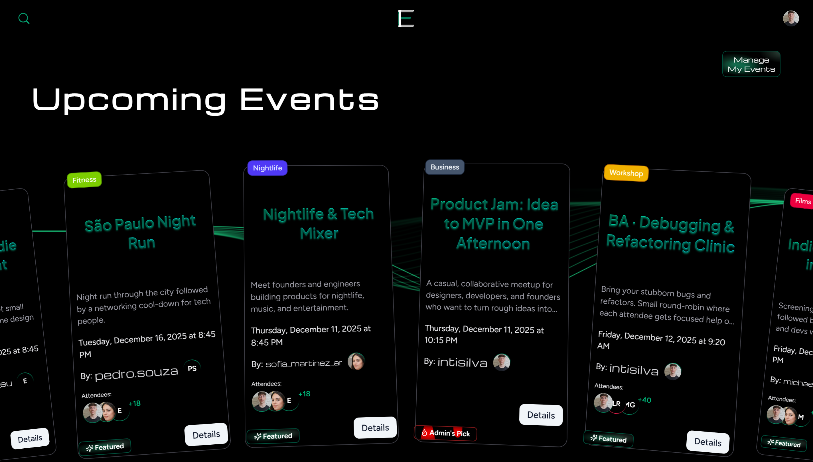
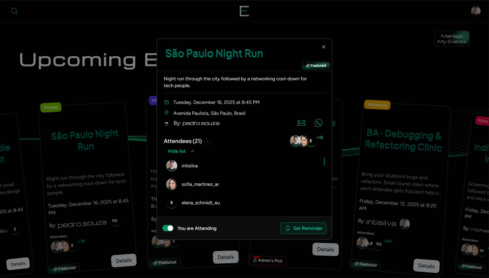
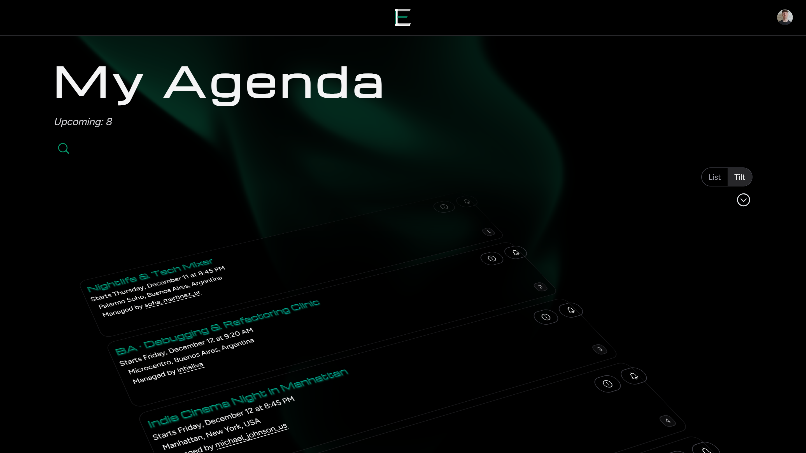
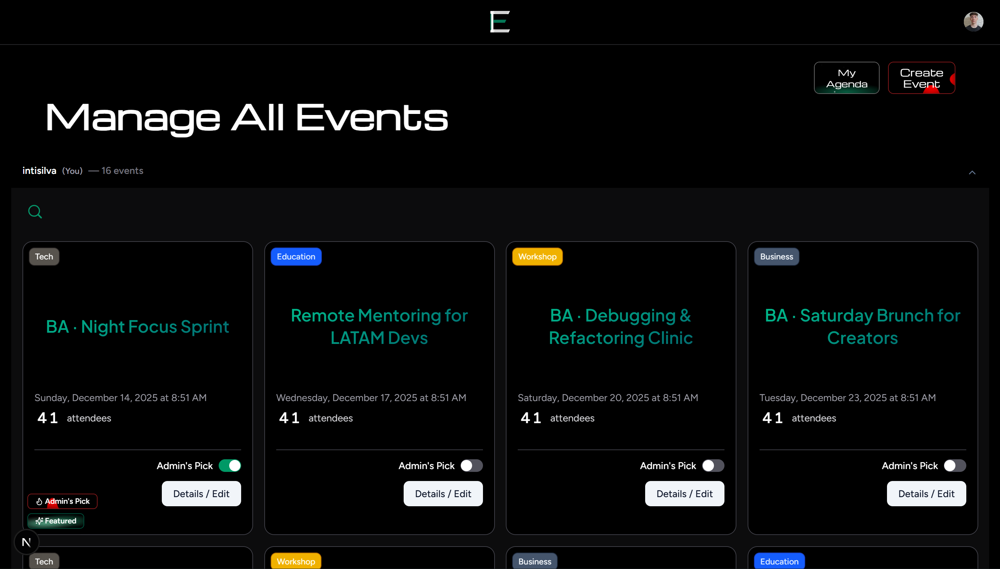

# Eventify

[](https://eventifylive.vercel.app)

Modern event discovery and management platform built with Next.js, Clerk, Prisma, and Tailwind CSS.  
Eventify lets admins and organizers publish events, collect RSVPs, and send automated reminders while giving attendees rich search, filtering, an animation-rich browsing experience, and agenda tools.

---

## Demo & Screenshots

- **Live demo**: [https://eventifylive.vercel.app](https://eventifylive.vercel.app)

**Screenshots:**

- 
- 
- 
- 

---

## Table of Contents

- [Overview](#overview)
- [Key Features](#key-features)
  - [UI & Animations](#ui--animations)
- [Tech Stack](#tech-stack)
- [Architecture / Folder Structure](#architecture--folder-structure)
- [Getting Started](#getting-started)
  - [Prerequisites](#prerequisites)
  - [Installation](#installation)
  - [Environment Variables](#environment-variables)
  - [E2E Environment (`.env.e2e`)](#e2e-environment-enve2e)
  - [Database Setup](#database-setup)
- [Development](#development)
- [Testing](#testing)
- [Deployment](#deployment)
- [Known Limitations & Roadmap](#known-limitations--roadmap)
- [Contributing](#contributing)
- [License](#license)

---

## Overview

Eventify is a full-stack web application built on the Next.js App Router. It supports authenticated, role-based experiences via Clerk, with dedicated dashboards for admins and organizers and a PostgreSQL database managed through Prisma.

It provides:

- Creation and moderation tools for events
- Attendee RSVP flows with reminder scheduling
- Automated transactional emails via Resend
- Timezone-aware ordering and agenda tools  
- A highly animated UI powered by Motion One and custom 3D/tilt effects

---

## Key Features

### Domain & Product Features

- **Role-based access control**  
  Admin, organizer, and user roles enforced at the middleware layer, with onboarding gates and protected routes for admin/organizer dashboards and event creation flows.

- **Profile & contact management**  
  Uses Clerk’s `UserButton` as the entry point to the account menu and extends the `UserProfile` view with a role-aware contact panel.  
  Organizers and admins get a dedicated phone number section (linked from an extra **“Contact”** item in the `UserButton` menu) so they can keep their event contact details in sync with their profile.

- **Event lifecycle management**  
  Create, update, and delete server actions validate business rules (time zone-aware date checks, contact requirements), normalize search fields, and revalidate relevant pages and cached lists.

- **Advanced filtering and search**  
  Search across title, location, category, date, and organizer with pagination helpers for organizer/admin views and homepage data loaders. Ordering is viewer timezone-aware so “today” and “upcoming” are computed correctly.

- **Timezone-aware scheduling & viewing**  
  Events are stored with both their absolute UTC timestamp and precomputed local keys (`eventLocalDateKey` and `eventLocalMinuteOfDay`) in the event’s own timezone.  
  On the frontend, a viewer timezone context detects the user’s timezone and orders lists (Home, Agenda, dashboards) by their local day. UI components expose a toggle between **event timezone** and **viewer timezone** so start times, “today”, and reminder windows are consistent and predictable.

- **RSVP system**  
  Tracks attendee status, reminder preferences, and unique per-user/event combinations in the database schema. Server actions enforce unique `(user, event)` constraints and keep reminders in sync with RSVP changes.

- **Featured events**  
  Featured events are automatically derived from RSVP thresholds with environment-configurable limits, plus explicit admin overrides. This allows “organic” popularity to surface events while still giving admins final control.

- **Automated reminders**  
  A cron endpoint `/api/cron/send-reminders` (secured by shared secret header + query) selects due reminders and dispatches transactional emails via Resend templates. Reminder types include day-of and 48-hours-before windows.

- **Email templates**  
  Reminder emails are built with React Email and can be previewed locally via scripts, making it easy to iterate on copy and layout.

- **Agenda & upcoming events**  
  Dedicated Agenda and Upcoming pages honor the viewer’s timezone for ordering and “today” logic. Data loaders and cookie-based timezone detection ensure consistent behavior across devices and sessions.

- **End-to-end coverage**  
  Playwright tests cover authentication, onboarding, event creation, filters, agenda flows, reminders, and role guards. Test flows rely on pre-seeded data and a dedicated E2E environment.

### UI & Animations

- **Motion One–driven interface**  
  Pervasive micro-interactions across cards, lists, navigation, onboarding flows, forms, and search/filters give the app a premium feel while honoring `prefers-reduced-motion`.

- **3D and tilt effects on event cards**  
  `ArcEventCard` components use perspective transforms, hover-driven floating states, and mirrored rotations in carousels so leading and trailing cards tilt in opposite directions.

- **Agenda’s `TiltedInfiniteList` engine**  
  Combines tilt, 3D perspective, parallax, autoplay, scroll/drag physics, and recentering of the peeked item to create an immersive, timeline-like event browsing experience.

- **Animated backgrounds with OGL**  
  Plasma, Threads, and Ripple Grid backgrounds render dynamic WebGL scenes with mouse/scroll interaction and safe fallbacks for reduced-motion users.

- **Animated icon system**  
  Lordicon-based icon components with configurable `in`, `hover`, `click`, `loop`, and `morph` animations provide rich feedback for key actions (navigation, empty states, reminders, etc.).

- **Animated typography & UI polish**  
  Kinetic headings, animated counters, button/hover feedback, and interactive search/filter panels with tuned easing/durations. The design emphasizes smooth micro-interactions, sensible defaults, and graceful behavior when animations are disabled.

---

## Tech Stack

- **Framework**: Next.js 15 (App Router) with React 19 and TypeScript  
- **Styling**: Tailwind CSS 4 + custom animated components and Radix UI primitives  
- **UI & Animation**: Motion One, OGL-powered backgrounds, Lordicon-based icon system  
- **Auth**: Clerk (user management, sessions, role metadata) with middleware-enforced RBAC  
- **Database**: PostgreSQL (Neon-friendly) via Prisma, with generated client in `src/generated/prisma`  
- **Email**: Resend + React Email templates for reminders  
- **Testing**: Vitest + Testing Library (unit/integration), Playwright (end-to-end flows)  

---

## Architecture / Folder Structure

High-level layout:

- `src/app/` – Next.js App Router routes
  - Public pages (home, event details, about, etc.)
  - `(dashboard)` area with admin, organizer, agenda, RSVP, and email template routes
  - API routes and cron endpoints under `/api`
- `src/components/` – UI building blocks and complex widgets
  - Forms, cards, animated backgrounds, navigation
  - Agenda widgets, admin/organizer dashboards
  - Animated text, icons, motion utilities
- `src/lib/` – Shared utilities
  - Data fetching and pagination helpers
  - Timezone and ordering helpers
  - Constants (featured thresholds, pagination)
  - Prisma client, reminder helpers, animation presets, cleanup routines
- `src/contexts/` – React context providers (event state, viewer timezone, menu context, etc.)
- `src/schemas/` – Zod schemas used across forms and server actions
- `prisma/` – Database schema and seed scripts (including E2E seed)
- `e2e/` – Playwright specs, auth fixtures, helpers, and global setup

Example tree (simplified):

```bash
src/
  app/
    (dashboard)/
      admin/
      organizer/
      agenda/
    api/
      events/
      rsvp/
      cron/
  components/
    Home/
    Menu/
    Agenda/
    common/
  contexts/
  lib/
  schemas/
prisma/
  schema.prisma
  seed-e2e.ts
e2e/
  helpers/
  01_smoke.spec.ts
  02_events.spec.ts
  ...
```

---

## Getting Started

### Prerequisites

- Node.js **18+**  
- npm (or pnpm/yarn if you adapt commands)  
- A PostgreSQL database (e.g., Neon or any compatible provider)  

### Installation

```bash
npm install
# or: pnpm install / yarn install
```

---

### Environment Variables

Create a `.env` file (or `.env.local` for Next.js) with the following keys (adapt as needed):

**Core**

- `DATABASE_URL` – PostgreSQL connection string for Prisma
- `NEXT_PUBLIC_SITE_URL` – Base site URL for metadata/SEO (defaults to `http://localhost:3000` if unset)

**Clerk / Auth**

- `CLERK_SECRET_KEY` – Clerk backend secret key
- `NEXT_PUBLIC_CLERK_PUBLISHABLE_KEY` – Clerk frontend publishable key
- `CLERK_WEBHOOK_SECRET` – Svix secret used to validate Clerk webhooks that sync users/roles into the database

**Email / Reminders**

- `RESEND_API_KEY` – Resend API key for transactional emails
- `EMAIL_FROM_ADDRESS` – Verified sender address used by Resend for reminder emails

**Cron / Featured Events**

- `CRON_SECRET` – Shared secret required (header + query) to access `/api/cron/send-reminders`
- `FEATURED_THRESHOLD` (optional) – Server-side default auto-feature threshold for confirmed RSVPs
- `NEXT_PUBLIC_FEATURED_THRESHOLD` (optional) – Client-side copy of the threshold for UI/tooltips

**Debug / Flags**

- `NEXT_PUBLIC_DEBUG_EVENTS` (optional) – Enable client debug mode for event context
- `NEXT_PUBLIC_E2E` (optional) – Flag to enable E2E-specific behavior/guards in UI and server actions

---

### E2E Environment (`.env.e2e`)

For end-to-end (E2E) testing, the project uses a separate environment file at the repo root: **`.env.e2e`**.  
This file points to a dedicated test database and a test-only Clerk environment so Playwright runs can safely reset and seed data without touching your main development or production DB.

Minimum keys:

- `NODE_ENV="test"` – ensures the app/tooling run in test mode
- `DATABASE_URL` – **test** database (e.g., a separate Neon branch named `e2e`)
- `NEXT_PUBLIC_CLERK_PUBLISHABLE_KEY` – Clerk publishable key for the test environment
- `CLERK_SECRET_KEY` – Clerk secret key for the test environment
- `CLERK_WEBHOOK_SECRET` – Svix signing secret for Clerk webhooks in the test environment

Additional E2E-related variables:

- `NEXT_PUBLIC_FEATURED_THRESHOLD` / `FEATURED_THRESHOLD` – testing threshold (e.g. `2` confirmed RSVPs)
- `NEXT_PUBLIC_E2E` – set to `1` to enable E2E-specific behavior
- `PW_INTERACTIVE` – set to `1` for more interactive Playwright runs when needed

Dev/test users in Clerk are configured via a set of `E2E_*` variables, for example:

- `E2E_FRESH_EMAIL`, `E2E_FRESH_PASSWORD`, `E2E_FRESH_USERNAME`
- `E2E_USER_CLERK_ID`, `E2E_USER_EMAIL`, `E2E_USER_PASSWORD`, `E2E_USER_USERNAME`
- `E2E_ORG_CLERK_ID`, `E2E_ORG_EMAIL`, `E2E_ORG_PASSWORD`, `E2E_ORG_USERNAME`, `E2E_ORG_PHONE`
- `E2E_ADMIN_CLERK_ID`, `E2E_ADMIN_EMAIL`, `E2E_ADMIN_PASSWORD`, `E2E_ADMIN_USERNAME`, `E2E_ADMIN_PHONE`

During E2E runs, the Playwright **global-setup** script uses these values to reconcile Clerk and the database:

- If a dev user from `.env.e2e` does not exist in Clerk, it is created.
- If it exists but its email/username differs from `.env.e2e`, it is updated in Clerk.
- After the E2E seed runs (which inserts users with placeholder `clerkId` values such as `e2e_admin`), the setup step rewrites those records to use the **real** Clerk user IDs.

This means you do not have to manually align the database with Clerk; keeping `.env.e2e` in sync with your dev users is enough.

---

### Database Setup

Generate the Prisma client and push/migrate the schema:

```bash
# Generate Prisma client
npx prisma generate

# Apply schema to the database
npx prisma db push   # or: npx prisma migrate dev
```

E2E seed data (used by Playwright flows) is available via:

```bash
npm run e2e:reset   # pushes schema to .env.e2e database
npm run e2e:seed    # seeds test users/events/reminders
```

---

## Development

Common development commands:

- Start the dev server (with Turbopack):

  ```bash
  npm run dev
  ```

- Lint the project:

  ```bash
  npm run lint
  ```

- Build and preview production:

  ```bash
  npm run build
  npm run start
  ```

- Preview email templates locally:

  ```bash
  npm run preview:email
  ```

---

## Testing

Eventify has **unit**, **integration**, and **end-to-end** tests.

### Unit / Integration (Vitest + Testing Library)

- Location: `src/**/__tests__` and related test files
- Commands:

  ```bash
  npm test           # run unit/integration tests
  npm run test:watch # watch mode
  npm run test:ci    # CI mode with coverage
  ```

### End-to-End (Playwright)

Requires `.env.e2e`, a dedicated test DB, and seeded data.

Typical flow:

```bash
npm run pree2e   # reset schema + seed E2E DB
npm run e2e      # run Playwright tests in headless mode
npm run e2e:ui   # run Playwright with UI
npm run e2e:report  # open HTML report (if configured)
```

Playwright specs cover:

- Homepage smoke flows
- Onboarding and role guards
- Event creation and editing
- Search filters and pagination
- Agenda / TiltedInfiniteList behavior
- Reminder scheduling and “too close to event” guards

---

## Deployment

Eventify is designed for deployment on **Vercel** with a managed PostgreSQL provider such as Neon:

1. **Provision Database**  
   Create a PostgreSQL instance (e.g., Neon) and set `DATABASE_URL` in your hosting environment.

2. **Set Environment Variables**  
   Configure the same env vars used locally (`DATABASE_URL`, Clerk keys, Resend keys, `CRON_SECRET`, etc.) in your Vercel project settings.

3. **Migrations / Schema**  
   Run `prisma db push` or `prisma migrate deploy` against the production database before (or as part of) deployment.

4. **Clerk Setup**  
   - Configure redirect URLs to match your deployed domain.
   - Set webhook endpoint to `/api/webhooks/clerk` using `CLERK_WEBHOOK_SECRET`.

5. **Email & Cron**  
   - Set `RESEND_API_KEY` and `EMAIL_FROM_ADDRESS`.
   - Configure an external cron (e.g., Vercel Cron) to call:

     ```text
     GET /api/cron/send-reminders?secret=<CRON_SECRET>
     Authorization: Bearer <CRON_SECRET>
     ```

Once configured, pushing to your main branch can trigger automatic deployments via Vercel.

---

## Known Limitations & Roadmap

- [ ] Reminder delivery depends on externally scheduled cron jobs; missing or misconfigured secrets will prevent sending and only log errors.
- [ ] Pick a provider and integrate image and video to events.
- [ ] Add Organizer's exclusive page profile, save previous organized events and maybe introduce a score functionality.
- [ ] Make full use of RSVPs "status" property, can be useful with payment integration.

---

## © 2025 Inti Silva. All rights reserved.
This code is for personal use only and is not authorized for commercial use or redistribution without the author's explicit permission.

